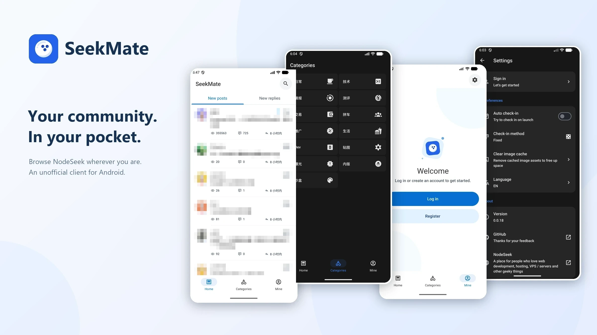

# SeekMate

[English](./README.md) | [简体中文](./README.zh-Hans.md)

SeekMate is an **unofficial NodeSeek client for Android**, built with Expo and React Native. Browse and participate in the community with a mobile-friendly experience.

## Screenshots

_Screenshots from version 0.0.18; the current interface may differ._

## Features

- **Browse** the latest topics and replies, or explore posts by category.
- **Read** posts and comments with pagination, pull-to-refresh, and load more.
- **Publish** posts with a rich-text editor and optional NodeImage uploads.
- **Search** posts and revisit recent searches.
- **View your profile**, account statistics, and recently viewed posts.
- **Check in** manually or automatically when the app launches.
- **Check notifications** for unread alerts and open the notification page on the NodeSeek website.

## Platform Support

Available on **Android**.

## Download

- [Google Play](https://play.google.com/store/apps/details?id=com.angiin.seekmate)
- [GitHub Releases](https://github.com/mrzhiin/seekmate/releases) (APK)

## Notes

Image uploads require a NodeImage API key, which can be configured in settings. The key is stored locally and sent to NodeImage when uploading; it is not synchronized remotely. It is cleared whenever you log in successfully (including re-login) or log out.

## License

This project is licensed under the [MIT License](./LICENSE).

## Acknowledgements

- [NodeSeek](https://www.nodeseek.com/)
- [Expo](https://expo.dev/)
- [React Native](https://reactnative.dev/)
